# Siaga

Satu halaman untuk saat gunung api erupsi. Halaman ini menjawab tiga pertanyaan:
**apa yang terjadi sekarang, apakah kotaku terdampak, dan apa yang harus kulakukan.**

Latar belakang: pada erupsi Anak Krakatau September 2026, unggahan warga menyebar lebih
cepat daripada pengumuman resmi. Orang tanpa media sosial tidak tahu apa-apa. Abu vulkanik
berbahaya untuk paru-paru dan mata.

Siaga menggabungkan **data resmi** (PVMBG, BMKG) dengan **perbincangan publik** (berita,
media sosial). Halaman memisahkan keduanya dengan jelas. Setiap informasi membawa **waktu**,
jadi pembaca tahu apakah informasi itu masih berlaku.

> **Bukan pengganti pengumuman resmi.** Untuk keputusan evakuasi, ikuti BPBD
> kabupaten/kota dan PVMBG. Untuk jadwal penerbangan, tanya maskapai.

## Istilah

README ini memakai satu kata untuk satu hal.

| Istilah | Arti |
|---|---|
| **Level** | Tingkat aktivitas gunung dari PVMBG: I Normal, II Waspada, III Siaga, IV Awas |
| **Status** | Penilaian Siaga untuk satu kota atau bandara: aman, waspada, siaga, bahaya |
| **Potret** | Satu hasil pengumpulan data (`/api/terkini`) |
| **Sumber** | Satu asal data, misalnya PVMBG atau BMKG |
| **Kabar** | Satu berita atau unggahan di tab Sumber |

## Tampilan

| Situasi | Kamera pemantau | Lokasimu |
|---|---|---|
| 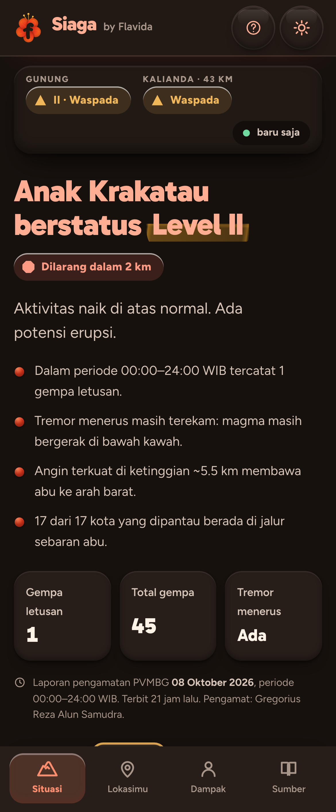 | 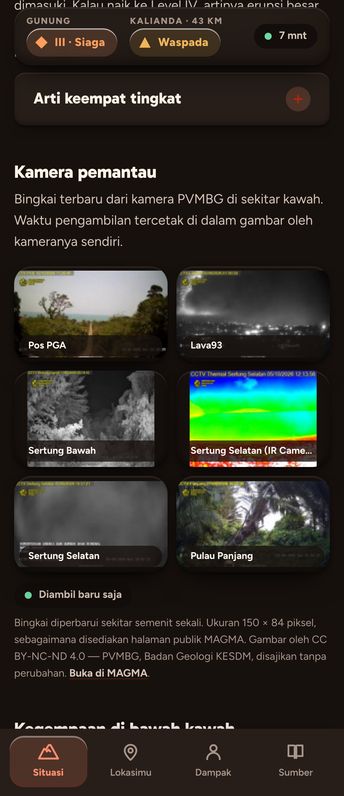 | 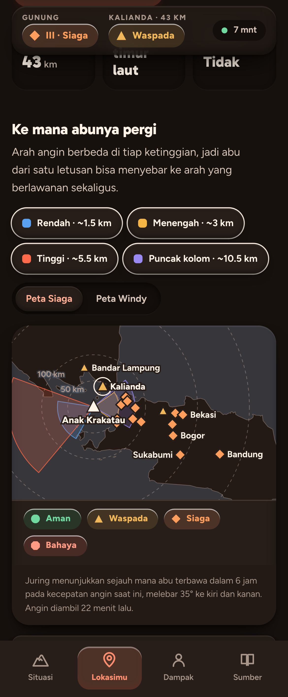 |

| Dampak | Infografis tindakan | Cara pakai |
|---|---|---|
| 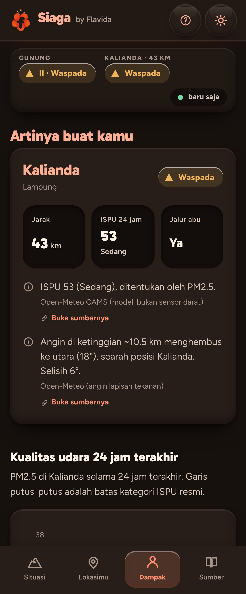 | 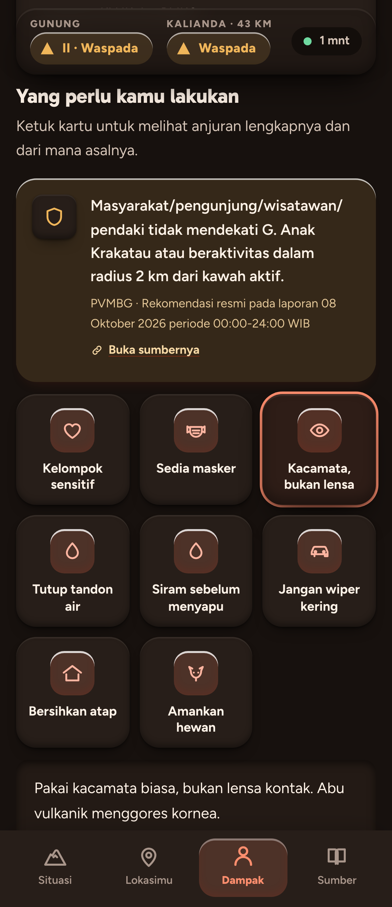 | 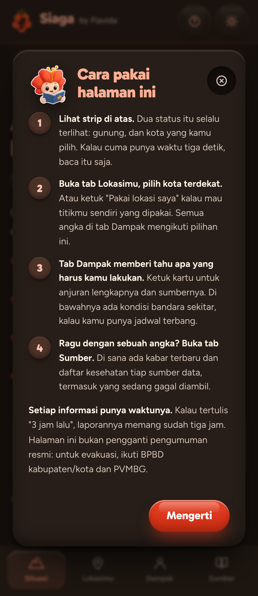 |

| Bandara (gelap) | Bandara (terang) | Linimasa sumber |
|---|---|---|
| 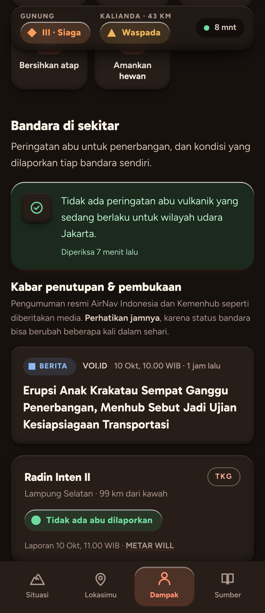 | 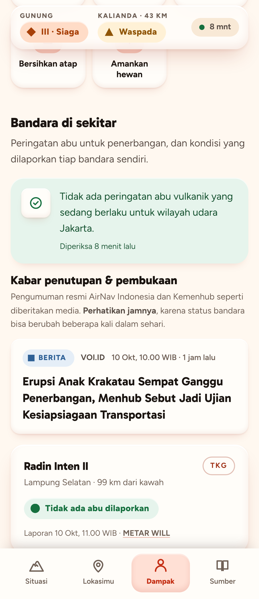 | 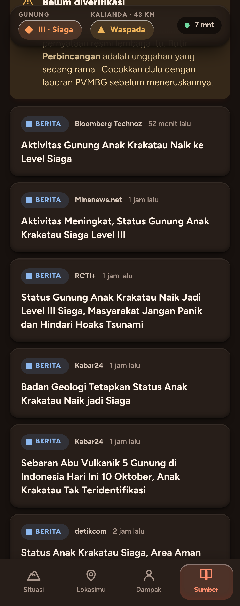 |

Layar lebar: navigasi pindah ke atas, kamera jadi tiga kolom.

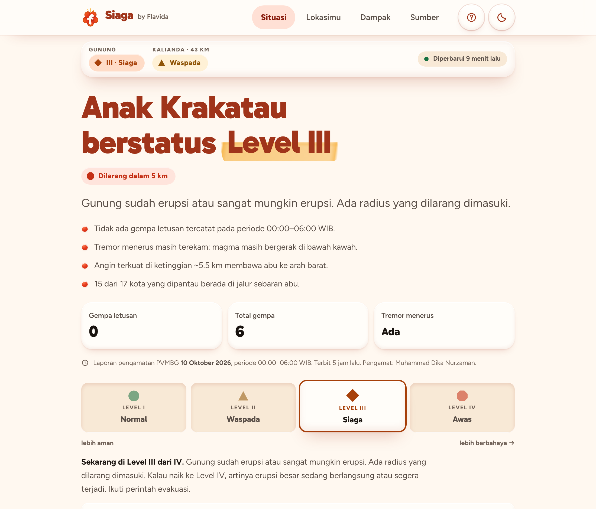

| Peta sebaran abu | Linimasa |
|---|---|
| 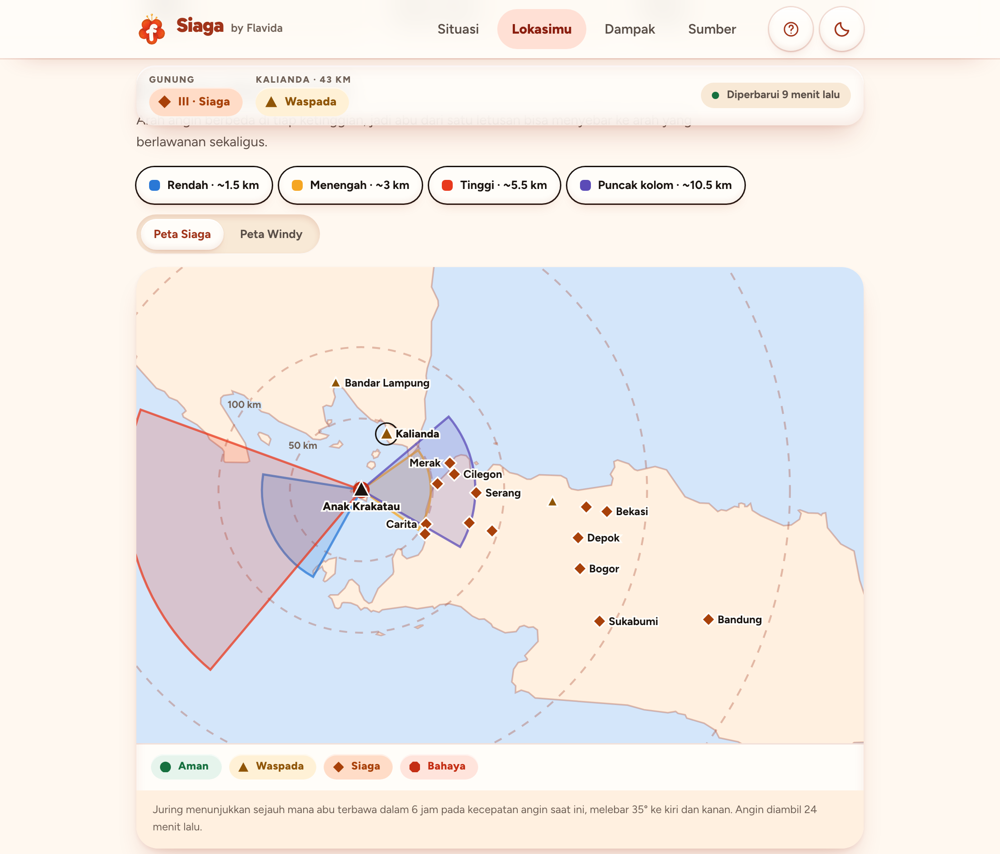 | 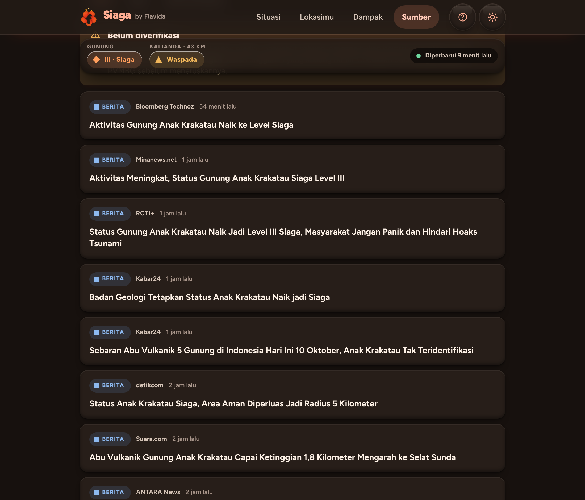 |

| Kualitas udara 24 jam | Lokasi perangkat | Mode terang | Lapisan Windy |
|---|---|---|---|
| 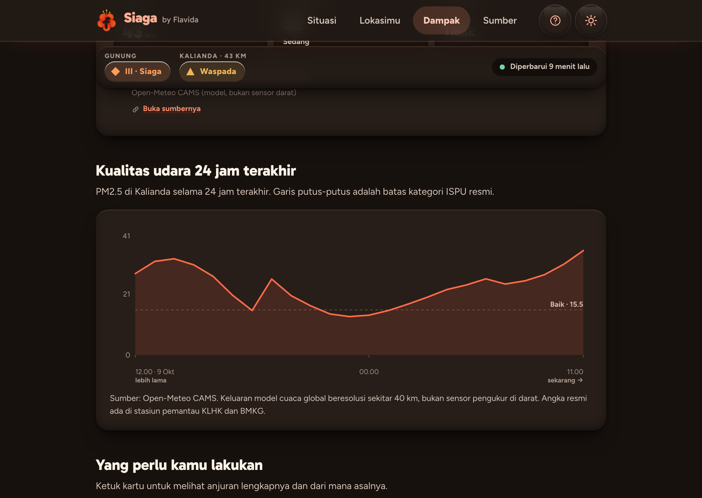 | 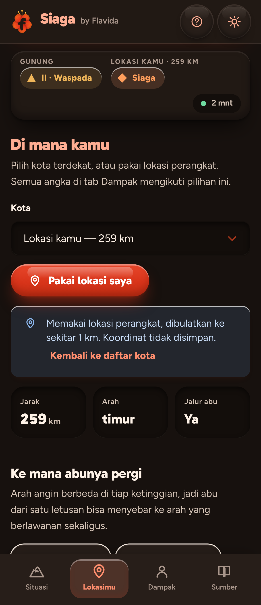 | 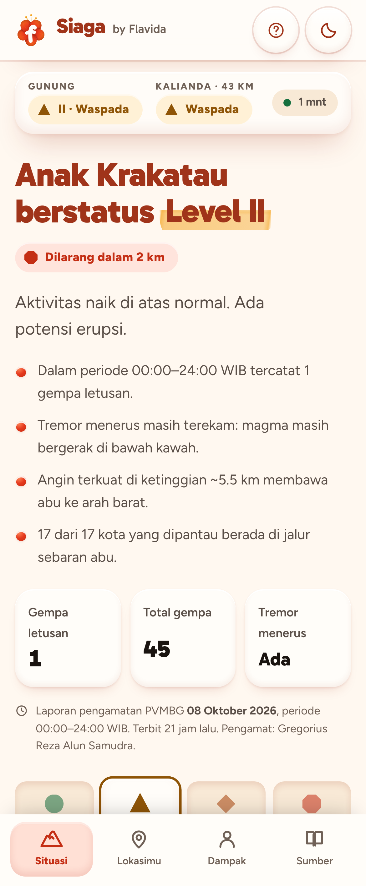 | 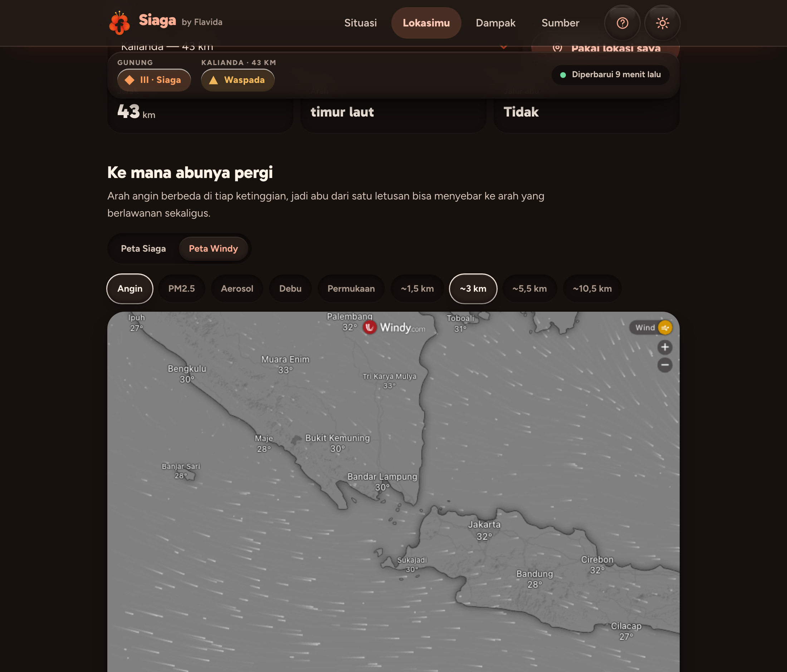 |

## Cara membaca halaman

Halaman punya empat tab. Satu tab aktif pada satu waktu, jadi tidak ada gulungan panjang
(sekitar 1.700–1.900 piksel per tab, dulu 6.300).

| Tab | Menjawab | Isi |
|---|---|---|
| **Situasi** | Apa yang terjadi di gunung? | Level, rekomendasi PVMBG, kamera, kegempaan |
| **Lokasimu** | Di mana aku, dan ke mana abunya? | Pemilih kota atau lokasi perangkat, peta sebaran, angin per ketinggian |
| **Dampak** | Artinya apa buat aku? | Status kota, ISPU, grafik udara 24 jam, tindakan, bandara |
| **Sumber** | Dari mana angka ini? | Kabar resmi dan perbincangan, kesehatan sumber, cara perhitungan |

- Di ponsel, tab ada di bawah layar. Di layar lebar, tab ada di atas.
- **Strip status** selalu terlihat. Strip menampilkan level gunung, status kotamu, dan umur data.
- Tombol **?** membuka panduan empat langkah. Dialognya memakai `<dialog>` bawaan peramban.

## Sumber data

Server menarik semua sumber tiap 10 menit. Tidak ada sumber yang butuh kunci berbayar.

| Sumber | Isi | Cara | Status |
|---|---|---|---|
| **MAGMA / PVMBG** — [tingkat aktivitas](https://magma.esdm.go.id/v1/gunung-api/tingkat-aktivitas) | Level semua gunung api | Baca HTML | ✅ |
| MAGMA — laporan 6 jam | Visual, kegempaan, **rekomendasi resmi**, radius larangan | Baca HTML (tautan bertanda tangan) | ✅ |
| MAGMA — laporan harian | Ringkasan harian | Baca HTML | ✅ |
| MAGMA — kamera | 6 kamera di sekitar kawah | Baca HTML, JPEG base64 | ✅ |
| **BMKG** — [`autogempa.json`](https://data.bmkg.go.id/DataMKG/TEWS/autogempa.json) | Gempa tektonik | JSON | ✅ |
| **Open-Meteo** Air Quality (CAMS) | PM2.5, PM10, SO₂ per kota, lalu ISPU | JSON | ✅ |
| Open-Meteo Forecast | Angin di 850/700/500/250 hPa di atas kawah | JSON | ✅ |
| **Google News** RSS | Kabar dari puluhan media | RSS | ✅ |
| RSS penerbit: ANTARA, CNN Indonesia, Tempo | URL asli dan gambar sampul | RSS | ✅ |
| **NOAA AWC** — [`isigmet`](https://aviationweather.gov/api/data/isigmet?format=raw) | SIGMET abu vulkanik FIR Jakarta | JSON | ✅ |
| NOAA AWC — [`metar`](https://aviationweather.gov/api/data/metar?ids=WIII&format=raw) | Kondisi tiap bandara: abu, jarak pandang, cuaca | JSON | ✅ |
| Google News — kueri penerbangan | Kabar penutupan dan pembukaan bandara | RSS | ✅ |
| **X** — endpoint sematan | Menemukan unggahan akun resmi | `__NEXT_DATA__` | ⚠️ tergantung reputasi IP |
| X — Nitter | Menemukan unggahan warga | RSS | ⚠️ perlu whitelist |
| X — [FxTwitter](https://github.com/FixTweet/FxTwitter) | Melengkapi unggahan: teks penuh, foto, video, metrik | `api.fxtwitter.com` | ✅ |
| **Threads** | Unggahan warga | Graph API | ❌ perlu App Review Meta ([panduan](docs/threads.md)) |
| **NOTAM** | Status buka/tutup bandara dari sumbernya | — | ❌ tidak ada saluran gratis |
| **Windy** (opsional) | Lapisan angin, PM2.5, aerosol | iframe | ✅ |

Halaman **tidak menyembunyikan sumber yang gagal**. Tab Sumber menampilkan status tiap
sumber dan pesan errornya.

### Catatan tiap sumber

**MAGMA.** MAGMA tidak punya API publik tanpa token, jadi server membaca HTML-nya.
- Kalau tata letak berubah, parser melempar error dan sumber ditandai gagal. Server tidak menampilkan data lama diam-diam.
- Kalau laporan gagal diambil, halaman memakai laporan tersimpan terakhir dan menyebut umurnya. Level tetap dari tabel tingkat aktivitas.
- MAGMA kadang membalas 403 saat ramai. Server mencoba ulang satu kali.
- Punya token MAGMA? Tambahkan di `src/sumber/magma.js`.

**Open-Meteo CAMS.** Ini keluaran model global beresolusi sekitar 40 km, bukan sensor darat.
Jakarta dan Bogor sering jatuh di sel yang sama dan menunjukkan angka identik. Halaman
menulis hal ini. Angka resmi ada di stasiun KLHK dan BMKG.

**X.** Menemukan unggahan dan membaca isinya adalah dua masalah berbeda.

| Peran | Dikerjakan oleh | Keandalan |
|---|---|---|
| Menemukan unggahan akun resmi | endpoint sematan X | Sering 429 dari IP pusat data. Biasanya lolos dari sambungan rumahan |
| Menemukan unggahan warga | instans Nitter | Pembaca RSS harus di-whitelist |
| Membaca isi unggahan | **FxTwitter** | Stabil, tanpa kunci |

- FxTwitter tidak bisa menemukan unggahan. `/latest`, `/timeline`, dan `/search` membalas 404. Server memakainya hanya untuk melengkapi tautan yang sudah ditemukan.
- Penemuan mati total? Isi `sumberX.postPilihan` di `config/config.json`. FxTwitter tetap bisa menarik unggahan itu.
- **Saringan relevansi:** unggahan media sosial lolos hanya kalau menyebut gunung yang dipantau atau kata di `sumberX.kataKunci`. Tanpa saringan, laporan gempa otomatis @infoBMKG dari seluruh Indonesia memenuhi halaman. Berita tidak disaring ulang karena kueri pencariannya sudah menyaring.
- **Nitter:** instans seperti `xcancel.com` meminta whitelist. Panggil sekali, ambil ID dari pesan error di tab Sumber, lalu kirim surel ke alamat yang mereka sebut.

**Threads.** Endpoint `keyword_search` ada. Tanpa App Review untuk izin
`threads_keyword_search`, endpoint hanya mengembalikan unggahan milik pemilik token. Langkah
lengkap ada di [docs/threads.md](docs/threads.md).

## Cara menghitung

**Tanpa LLM.** Semua status dan rekomendasi keluar dari aturan di `src/analisa.js` dan
`config/ambang.json`. Setiap tindakan membawa **dasar** (aturan yang jalan) dan **sumber**
(asal angka).

### Status gunung

Status gunung adalah level PVMBG. Siaga tidak menafsirkannya ulang. Halaman menampilkan
empat level sebagai tangga, menyorot level sekarang, dan menjelaskan level berikutnya.

| Level | Nama | Arti |
|---|---|---|
| I | Normal | Tidak ada gejala tekanan magma yang berarti |
| II | Waspada | Aktivitas naik di atas normal. Ada potensi erupsi |
| III | Siaga | Gunung sudah erupsi atau sangat mungkin erupsi. Ada radius larangan |
| IV | Awas | Erupsi besar sedang atau segera terjadi. Ikuti perintah evakuasi |

### Status kota

Siaga mengambil status **tertinggi** dari tiga aturan.

1. **Zona larangan.** Radius dibaca dari teks rekomendasi PVMBG (`radius 3 km`). Kota di dalam radius: **bahaya**. Teks tanpa radius menghasilkan `null`, dan aturan ini tidak jalan.
2. **Kualitas udara.** ISPU dihitung dari rata-rata bergerak 24 jam PM2.5, PM10, dan SO₂. Rumusnya interpolasi linier antar titik patah **Permen LHK No. P.14/2020**, dan parameter dominan menang. Baik: aman. Sedang: waspada. Tidak Sehat: siaga. Sangat Tidak Sehat dan Berbahaya: bahaya.
3. **Jalur abu.** Kota ada di jalur kalau arahnya dari kawah berada dalam ±35° dari arah angin di salah satu lapisan, dan jaraknya di bawah 400 km. Hasil minimal: **waspada**.

Status gunung dan status kota **tidak dicampur**. Kota 250 km dengan udara bersih tidak jadi
siaga hanya karena gunung di Level III.

### Ringkasan situasi

Kalimat pembuka di tab Situasi dirangkai ulang tiap data masuk. Isinya: jumlah gempa letusan,
status erupsi menerus, tremor, arah angin terkuat, dan jumlah kota di jalur abu. Angka yang
tidak ada di laporan tidak ditulis.

### Rekomendasi tindakan

Empat asal, semuanya dikutip apa adanya:

- **Rekomendasi resmi PVMBG.** Disalin verbatim.
- **Tindakan menurut kategori ISPU.** Mengikuti Permen LHK P.14/2020 Lampiran III.
- **Tindakan abu vulkanik.** Dari IVHHN dan Kemenkes: masker N95, kacamata (bukan lensa kontak), tutup tandon air, siram sebelum menyapu, jangan pakai wiper kering.
- **Aturan zona larangan**, kalau kota ada di dalam radius.

Setiap anjuran punya tautan rujukan. Tautan ada di `sumberTautan` pada `config/ambang.json`.
Ubah ambang? Ubah juga rujukannya. Data kosong menghasilkan keluaran kosong, bukan nilai bawaan.

## Kamera pemantau

PVMBG punya enam kamera di sekitar Anak Krakatau: Pos PGA, Lava93, Sertung Bawah, Sertung
Selatan, Sertung Selatan (IR), dan Pulau Panjang. Halaman daftar MAGMA menyematkan bingkai
terbaru sebagai JPEG base64. Server membaca gambar yang sama.

- **Pembaruan:** sekitar satu menit sekali. Kamera mencetak waktu di dalam gambar, jadi pembaca bisa memeriksanya sendiri.
- **Ukuran:** 150 × 84 piksel. Gambar penuh ada di balik endpoint ber-CSRF dan tidak diambil.
- **Penyajian:** server menyajikan bingkai di `/api/cctv/<n>.jpg` dengan singgahan 45 detik. Peramban pembaca tidak menghubungi MAGMA, dan tanda tangan URL tidak bocor. MAGMA menerima paling banyak satu permintaan per 45 detik, berapa pun jumlah pembaca. Enam permintaan serentak memakai satu pengambilan.
- **Rasio:** server membaca rasio tiap kamera dari berkas JPEG. Dua kamera merekam 150 × 113. Bingkai yang gagal memuat menampilkan keterangan, bukan ikon rusak.
- **Perbesar:** ketuk bingkai. Batasnya 320 px, karena sumbernya hanya 150 px.
- **Lisensi:** CC BY-NC-ND 4.0, PVMBG Badan Geologi. Siaga menyajikan gambar tanpa perubahan, dengan atribusi dan tautan balik. Lisensi ini tidak mengizinkan pemakaian komersial.

## Bandara dan penerbangan

Blok ini ada di tab **Dampak**. Blok menjawab apa yang bisa dijawab dari data terbuka, tidak lebih. Tiga lapisan:

**1. Kabar penutupan dan pembukaan.** Kueri Google News: `(bandara OR penerbangan) (krakatau OR "abu vulkanik")`. Urutan terbaru di atas, jam terbit ditulis jelas. Isinya pengumuman AirNav dan Kemenhub seperti diberitakan.
- **Saringan judul:** judul harus menyebut penerbangan **dan** abu atau erupsi (`kabarBandaraRelevan` di `src/kumpul.js`). Google News mencocokkan seluruh isi artikel. Tanpa saringan, daftar terisi berita bandara yang tidak relevan.
- **Saringan umur:** maksimal 72 jam. Status bandara berubah dalam hitungan jam.
- **Kosong:** halaman menulis bahwa tidak ada kabar, dan bahwa itu bukan jaminan bandara normal.
- **Kartu bandara:** judul yang menyebut nama bandara muncul di kartunya, satu judul terbaru. Pencocokan memakai `alias` di config (`"soetta"`, `"halim"`), bukan nama kota.
- Halaman **tidak meringkas** judul menjadi lencana buka/tutup. Status berubah beberapa kali sehari. Pembaca menilai dari jam terbit.

**2. SIGMET abu vulkanik.** SIGMET jenis `VA` adalah peringatan resmi: awan abu teramati di satu wilayah udara. Isinya batas area, ketinggian, arah, kecepatan, dan masa berlaku. Untuk Selat Sunda, penerbitnya kantor meteorologi penerbangan Jakarta (`WIII`) untuk FIR Jakarta (`WIIF`). Halaman menampilkan teks aslinya di balik "Teks aslinya". Contoh (8 September 2026):

```
WVID20 WIII 072330
WIIF SIGMET 13 VALID 072330/080530 WIII- WIIF JAKARTA FIR VA ERUPTION
MT KRAKATAU PSN S0606 E10525 VA CLD OBS AT 2310Z WI S0600 E10541 -
S0832 E10519 - S0820 E10341 - S0630 E10259 - S0545 E10524 - S0600
E10541 SFC/FL070 MOV SW 15KT NC=
```

**3. METAR.** METAR adalah laporan cuaca stasiun meteorologi di bandara, tiap 30 menit. Siaga membaca sandi cuaca (`VA` abu, `HZ` kabut asap, `BR` kabut tipis, `FU` asap) dan jarak pandang.

Lapisan 2 dan 3 datang dari [Aviation Weather Center](https://aviationweather.gov) (NOAA). AWC menyalurkan ulang pertukaran OPMET dunia. Isinya tetap terbitan Indonesia.

### Kenapa lewat pemberitaan

NOTAM membawa keputusan tutup bandara. Penerbitnya AirNav Indonesia. Tidak ada jalur langsung yang gratis. Semua jalur ini sudah dicoba:

| Dicoba | Hasil |
|---|---|
| `external-api.faa.gov/notamapi` | `401`, butuh kunci FAA |
| `notams.aim.faa.gov/notamSearch` | `403` |
| `www.notams.faa.gov` (DINS) | nama host tidak beralamat |
| `aim.dephub.go.id`, `notam.airnavindonesia.co.id` | nama host tidak beralamat |
| `api.autorouter.aero` | `401`, butuh OAuth |
| `aviation.bmkg.go.id` | `403` |
| `injourneyairports.id` | situs SPA. `api.injourneyairports.id` membalas "We're currently performing maintenance" |
| `cms.injourneyairports.id` | halaman masuk CMS |
| X `@djpu151`, `@AirNavIndonesia` | akun ada, linimasa tidak terbaca: sematan `429`, Nitter `302`/`403`/`429`, `rss.xcancel.com` minta whitelist |
| X `@Soetta_Airport` | `404`, akun tidak ada |

Jalur yang hidup adalah pemberitaan. Halaman menulis bahwa kabar ini datang **lewat media**
dan bisa tertinggal beberapa menit. Halaman **tidak pernah menyimpulkan** buka atau tutup.
Satu [uji otomatis](test.js) memastikan tidak ada label yang menyiratkannya.

### Aturan status bandara

Status hanya soal abu, karena hanya itu yang teramati.

| Kondisi | Status | Label |
|---|---|---|
| Sandi `VA` ada di METAR | bahaya | Abu teramati |
| Titik bandara di dalam poligon SIGMET yang berlaku | siaga | Di area peringatan abu |
| Ada METAR, tidak keduanya | aman | Tidak ada abu dilaporkan |
| METAR tidak masuk | `null` | Laporan cuaca belum masuk |

- Uji "di dalam area" memakai algoritma lemparan sinar (`didalamPoligon` di `src/analisa.js`).
- **Jarak pandang tidak menaikkan status.** Soekarno-Hatta rutin melaporkan 4 km berkabut asap di pagi biasa. Alarm yang selalu bunyi berhenti dibaca.
- **SIGMET gagal diambil bukan berarti tidak ada peringatan.** Halaman menulis "gagal".

### Bandara yang dipantau

Siaga hanya memantau bandara yang menerbitkan METAR ke pertukaran OPMET dunia.

| ICAO | IATA | Bandara | Jarak dari kawah |
|---|---|---|---|
| `WILL` | TKG | Radin Inten II, Lampung Selatan | 99 km |
| `WIII` | CGK | Soekarno-Hatta, Tangerang | 136 km |
| `WIHH` | HLP | Halim Perdanakusuma, Jakarta Timur | 163 km |
| `WIPP` | PLM | Sultan Mahmud Badaruddin II, Palembang | 365 km |

Husein Sastranegara (`WICC`), Kertajati (`WICA`), dan Pondok Cabe (`WIHP`) tidak menerbitkan
METAR ke pertukaran itu. Siaga tidak memasukkannya.

Tambah bandara dengan satu baris di `config/config.json` → `bandara`:

```json
{ "icao": "WARR", "iata": "SUB", "nama": "Juanda", "kota": "Sidoarjo",
  "provinsi": "Jawa Timur", "lat": -7.380, "lon": 112.787, "alias": ["juanda"] }
```

`firPenerbangan` mengatur FIR untuk SIGMET (bawaan `["WIIF"]`). Tambah `"WAAF"` untuk
Ujung Pandang. Tambahkan hanya kalau gunung yang dipantau ada di Indonesia timur.

## Lokasi perangkat

Tombol **"Pakai lokasi saya"** memakai geolocation peramban. Siaga mengganti kota dengan titik
pengguna, lalu menghitung ulang jarak, arah, ISPU, jalur abu, dan tindakan.

- Peramban **tidak meminta izin saat halaman dibuka**. Pengguna menekan tombolnya.
- Peramban membulatkan koordinat ke 2 desimal (~1,1 km), dan server membulatkan lagi. Sel model udara selebar 40 km, jadi ketelitian lebih tidak berguna.
- Koordinat dikirim lewat badan **POST**, bukan query string. Koordinat tidak masuk access log, riwayat, atau header `Referer`.
- Server **tidak menyimpan** koordinat. Hanya ada singgahan memori 10 menit, berkunci koordinat bulat.
- Izin ditolak, posisi gagal, atau waktu habis: halaman menampilkan pesan khusus dan kembali ke pemilih kota.

Halaman berfungsi penuh tanpa izin lokasi.

## Tema

Ada dua pilihan: **terang** dan **gelap**. Tanpa pilihan tersimpan, `<html data-theme="auto">`
mengikuti perangkat, termasuk saat perangkat berganti tema sendiri. Setelah tombol ditekan,
pilihan tersimpan (`light` atau `dark`) dan menang.

- Tombol menampilkan **tujuan**: ikon bulan berarti "ganti ke gelap".
- `?tema=terang` atau `?tema=gelap` memaksa tema, berguna untuk berbagi tautan atau tangkapan layar.
- Token kit memetakan ulang warna untuk mode gelap. Semua warna di `gaya.css` dan di grafik SVG memakai `var(--token)`, jadi tema berganti tanpa menggambar ulang.
- Skrip kecil di `<head>` memasang tema sebelum halaman digambar, jadi tidak ada kedipan.
- Di tabel kota, baris yang dipakai **ditebalkan** dan bergaris di tepi kiri. Status tiap kota tampil sebagai `.fl-level`: bentuk, warna, dan kata. Di layar sempit tabel menjadi kartu bertumpuk.

## Lapisan Windy

Toggle **"Peta Windy"** menampilkan `embed.windy.com` (model ECMWF dan CAMS). Empat lapisan sudah diuji satu per satu:

| Lapisan | Kunci | Isi |
|---|---|---|
| Angin | `wind` | Arah dan kecepatan. Ketinggian: permukaan, ~1,5 / 3 / 5,5 / 10,5 km |
| PM2.5 | `pm2p5` | Partikel halus, µg/m³ |
| Aerosol | `aod550` | Ketebalan optik aerosol, paling dekat dengan sebaran abu |
| Debu | `dustsm` | Debu permukaan, µg/m³ |

`so2` tidak dipakai. Embed Windy menerimanya tanpa error, tapi diam-diam menggambar lapisan angin.

Lapisan ini **tidak aktif sejak awal** dan meminta persetujuan sekali. Membukanya berarti
peramban menghubungi windy.com, dan mereka melihat IP pembaca. Peta bawaan Siaga tidak
memanggil siapa pun, jadi tetap yang utama. Saat toggle mati, server membuang iframe.

## Desain

Tampilan memakai **Flavida Design System v4.1 "Flame-tree clay"**: permukaan puffy, kartu 20 px,
panel 24 px, tombol pil yang menekan ke dalam, Gabarito untuk judul, Figtree untuk teks. Font
di-host sendiri, jadi tidak ada permintaan ke pihak ketiga. `public/flavida/VERSI.txt` mencatat
commit kit yang dipakai.

**Kit disalin, tidak ditulis ulang.** `scripts/ambil-kit.sh` menyalin empat CSS, dua font, tanda
logo, dan dua stiker ke `public/flavida/`. Jangan edit isinya. Kit berubah? Jalankan skrip lagi
dan naikkan `?v=` di `index.html`. `gaya.css` hanya memuat yang tidak ada di kit.

**Komponen kit yang dipakai:** `.fl-nav`, `.fl-strip`, `.fl-level`, `.fl-fresh`, `.fl-src`, `.fl-cam`,
`.fl-feed`, `.fl-health`, `.fl-stat`, `.fl-callout`, `.fl-alert`, `.fl-chartcard`, `.fl-dt`,
`.fl-accordion`, `.fl-seg`, `.fl-dialog`, `.fl-tabbar`, `.fl-marker`. Polanya dari
`patterns/dashboard.html` di kit, yang menyebut Siaga sebagai pemakai.

**Yang tidak dipakai:** Motion, `flavida.js`, dan sprite ikon kit. Halaman bergerak lewat CSS saja
(hover mengangkat, tekan melesak, kerucut abu menyapu sekali; semuanya mati di
`prefers-reduced-motion`). Hemat 36 KB gzip (Motion 24, `flavida.js` 8, sprite 3).

**Status bukan warna saja.** `.fl-level` memakai lingkaran (aman), segitiga (waspada), belah
ketupat (siaga), segi delapan (bahaya), plus kata. Penanda kota di peta dan legendanya memakai
bentuk yang sama, jadi peta terbaca dalam skala abu-abu. Peta punya padanan tabel.

**Flav muncul di dua tempat:** dialog "Cara pakai" dan galat status resmi. Di tempat lain, data
yang berbicara.

**Grafik** memakai `--chart-1..8`. Empat lapisan angin di peta memakai rona berbeda supaya
kerucut bertumpuk tetap terbaca.

## Arsitektur

```
server.js              satu proses: berkas statis + /api/* + penjadwal
src/
  util.js              HTTP (satu coba ulang), parser HTML, jarak dan arah
  analisa.js           aturan: ISPU, radius, jalur abu, status kota dan bandara, tindakan
  db.js                skema SQLite + potret JSON
  kumpul.js            kolektor: tarik sumber, hitung, tulis potret
  sumber/
    magma.js           PVMBG: tingkat aktivitas, laporan 6 jam, laporan harian
    bmkg.js            gempa tektonik
    cuaca.js           Open-Meteo: udara dan angin per lapisan
    publik.js          Google News, X (sematan/Nitter/FxTwitter), Threads
    penerbangan.js     SIGMET abu dan METAR (NOAA AWC). Tanpa NOTAM
config/
  config.json          gunung, kota, bandara + alias, FIR, interval, sumber X
  ambang.json          titik patah ISPU, level, teks tindakan, semua bersitasi
public/
  index.html           satu halaman, tanpa langkah build
  gaya.css             lapisan Siaga di atas kit (peta, tangga level, ubin kamera)
  flavida/             kit Flavida v4.1, disalin apa adanya
  app.js               peta SVG, kompas angin, grafik: vanilla, tanpa kerangka kerja
  coastline.json       garis pantai Selat Sunda, 7 KB (Natural Earth 10m)
test.js                42 pemeriksaan, tanpa framework
scripts/
  tangkap.mjs          tangkapan layar README lewat CDP + pemeriksaan tata letak
  ambil-kit.sh         salin kit dari ../flavida-design-system
  garis-pantai.mjs     buat ulang coastline.json (sekali jalan)
docs/threads.md        cara mendapatkan token Threads
```

**Nol dependensi npm.** Node 25 membawa `fetch`, `node:sqlite`, `node:http`, dan `WebSocket`.
Tidak ada `npm install` dan tidak ada rantai pasok. `docker build` hanya menyalin berkas.
Halaman tanpa kerangka kerja dan tanpa langkah build.

**Singgahan.** Halaman induk memakai `no-cache` **dengan ETag**. Aset memakai `?v=…` dan
`immutable` setahun. Font memakai `max-age` sebulan. Tanpa ETag, `no-cache` saja membuat
peramban memakai salinan lama. Bug ini pernah menahan perbaikan sampai ke pembaca.

**Muat pertama.** Permintaan yang jatuh saat server mengumpulkan data (503) diulang dengan
jeda naik sampai 30 detik, dan spanduk menjelaskan keadaannya.

**`Vary`.** Isi `/api/terkini`, halaman, dan aset teks berbeda menurut `Accept-Encoding`
(17 KB gzip lawan 133 KB polos). Tanpa `Vary: Accept-Encoding`, singgahan bersama bisa
menyajikan byte terkompresi ke pembaca yang tidak meminta gzip. Bug ini muncul hanya saat ada
CDN atau proksi di depan layanan.

**Ikon.** `ikon()` memberi kelas `.fl-icon` (`1.25em`). Tanpa ukuran, `<svg>` tanpa
`width`/`height` menjadi 300 × 150 dan berubah jadi balok raksasa. Ikon digambar di
`index.html` dengan garis 2 px berujung bulat, sepadan dengan set Lucide di kit.

### JSON dan SQLite

- **Potret terkini: satu berkas JSON** (`data/terkini.json`). Server membaca utuh tiap permintaan, menulis atomik lewat rename, dan potret bertahan saat proses restart.
- **Riwayat: SQLite** (`data/siaga.db`). Data tumbuh terus dan butuh kueri rentang: laporan per periode, deret udara per kota, unggahan yang pernah terlihat, riwayat kesehatan sumber. MAGMA hanya menampilkan laporan terbaru, jadi **tren kegempaan hanya ada kalau Siaga menyimpannya**.

Aturan praktis: dibaca utuh dan ukuran tetap, pakai berkas. Tumbuh tanpa batas atau perlu
disaring per rentang, pakai SQLite. Untuk skala ini, Postgres hanya menambah satu layanan.

## Menjalankan di homelab

### Docker Compose

```bash
git clone git@github.com:arnantoakbar/siaga.git
cd siaga
docker compose up -d --build
```

Buka `http://<ip-homelab>:8080`. Pengumpulan pertama butuh 10–15 detik. Sebelum selesai,
`/api/terkini` membalas 503 dan halaman menampilkan keadaan memuat.

### Tanpa Docker

```bash
node --version    # butuh 24 atau lebih baru (node:sqlite bawaan)
node server.js
```

### systemd

```ini
# /etc/systemd/system/siaga.service
[Unit]
Description=Siaga
After=network-online.target

[Service]
Type=simple
User=siaga
WorkingDirectory=/opt/siaga
ExecStart=/usr/bin/node server.js
Environment=TZ=Asia/Jakarta
Environment=PORT=8080
Restart=always
RestartSec=10

[Install]
WantedBy=multi-user.target
```

```bash
sudo systemctl enable --now siaga
```

### CDN di depan layanan

Beban terbesar ke homelab adalah **tab yang dibiarkan terbuka**, bukan kunjungan pertama. Tiap
60 detik, satu tab di tab Situasi menarik `/api/cctv` dan enam bingkai: sekitar 33 KB dan 7
permintaan per menit per tab. Seribu tab: 7.000 permintaan per menit.

Penanda `?t=` pada bingkai berasal dari **waktu pengambilan di server**, bukan jam pembaca.
Semua pembaca dalam satu jendela memakai kunci singgahan yang sama.

Buat dua aturan di Cloudflare (Rules → Cache Rules):

| Cocokkan | Setelan |
|---|---|
| `http.request.uri.path eq "/api/terkini"` | Eligible for cache, Edge TTL **60 detik**, abaikan header asal |
| `starts_with(http.request.uri.path, "/api/cctv")` | Eligible for cache, Edge TTL **45 detik**, abaikan header asal |

Pilih "abaikan header asal" karena layanan mengirim `Cache-Control: no-cache` di kedua jalur.

- **Jangan** membuat satu aturan `/api/*`. Aturan itu ikut menyinggahkan `/api/kesehatan`, dan pemantauan uptime membaca jawaban lama.
- `/api/lokasi` memakai POST. Jangan masukkan ke aturan apa pun.
- Aset `?v=…` sudah `immutable`. Cloudflare menyinggahkannya tanpa aturan.
- Jangan singgahkan halaman induk di tepi. Halaman induk menentukan versi aset.
- Konsekuensi: data bisa tertinggal sampai 60 detik. Pengumpulan berjalan tiap 10 menit, jadi selisih ini kecil.

Periksa aturan:

```bash
curl -sI https://siaga.domainkamu.id/api/terkini | grep -i cf-cache-status
```

`HIT` berarti Cloudflare menjawab. `MISS` pada permintaan pertama tiap jendela itu wajar.

### Reverse proxy

Caddy:

```
siaga.domainkamu.id {
    reverse_proxy localhost:8080
}
```

Nginx:

```nginx
server {
    server_name siaga.domainkamu.id;
    location / {
        proxy_pass http://127.0.0.1:8080;
        proxy_set_header Host $host;
        proxy_set_header X-Forwarded-For $proxy_add_x_forwarded_for;
    }
}
```

Layanan tidak butuh basis data eksternal, tidak menyimpan data pengunjung, dan tidak memasang
cookie. Peramban hanya menyimpan kota terakhir, tema, dan persetujuan Windy di `localStorage`.

### Variabel lingkungan

| Nama | Bawaan | Arti |
|---|---|---|
| `PORT` | `8080` | Port dengar |
| `INTERVAL_MENIT` | `10` | Selang pengumpulan |
| `TZ` | `Asia/Jakarta` | Zona waktu |
| `THREADS_TOKEN` | — | Token Threads (butuh App Review) |

### Endpoint

| Endpoint | Isi |
|---|---|
| `GET /api/terkini` | Seluruh potret: status, kota, angin, kabar, kesehatan sumber |
| `GET /api/kesehatan` | Ringkas untuk pemantauan. Membalas 503 kalau potret lebih tua dari 3× interval |
| `GET /api/cctv` | Daftar kamera, waktu pengambilan, lisensi |
| `GET /api/cctv/<n>.jpg` | Bingkai terbaru satu kamera |
| `POST /api/lokasi` | Analisa satu titik. Badan `{"lat":-6.92,"lon":107.62}`. Tidak menyimpan apa pun |
| `POST /api/segarkan` | Paksa pengumpulan sekarang |

`/api/kesehatan` cocok untuk Uptime Kuma atau healthcheck Docker.

## Konfigurasi

Semua di `config/config.json`, kecuali ambang.

**Tambah kota.** Server menghitung jarak dan arah sendiri.

```json
{ "id": "cilacap", "nama": "Cilacap", "provinsi": "Jawa Tengah", "lat": -7.727, "lon": 109.010 }
```

Kota di luar kotak peta? Geser `PETA` di `public/app.js`, lalu buat ulang garis pantai:

```bash
node scripts/garis-pantai.mjs <barat> <selatan> <timur> <utara>
```

(sumber: Natural Earth `ne_10m_land`)

**Pantau gunung lain.** Ubah `gunung`. `nama` harus sama persis dengan tabel tingkat
aktivitas MAGMA (`"Semeru"`, `"Merapi"`, `"Ibu"`). Level, laporan, rekomendasi, angin, dan
udara ikut berganti.

**Tempel unggahan X manual.** Penemuan otomatis mati? Isi `sumberX.postPilihan`. FxTwitter
mengambil isinya tanpa kunci dan tanpa akun. Kosongkan daftar kalau sudah tidak relevan. Repo membawa dua pengumuman BMKG September 2026 sebagai contoh.

```json
"postPilihan": ["https://x.com/infoBMKG/status/2096418871880339807"]
```

**Ubah ambang.** `config/ambang.json` memuat titik patah ISPU, peta level, sektor jalur abu, dan
teks tindakan. Tiap kelompok punya `_sumber`. **Ubah angka? Ubah juga sitasinya.** Tidak boleh
ada ambang tanpa dasar.

## Uji

```bash
node test.js
```

42 pemeriksaan, tanpa framework. Fokusnya logika yang membuat orang salah mengambil keputusan:

- interpolasi ISPU di tiap titik patah
- pembacaan radius larangan (termasuk "tidak ada radius" yang harus menghasilkan `null`)
- sektor jalur abu saat menyeberang 0°
- konversi WIB ke UTC
- poligon SIGMET, sandi METAR, dan jarak pandang
- saringan berita bandara
- larangan label "buka" atau "tutup" untuk bandara
- regresi: footer MAGMA pernah terbaca sebagai rekomendasi keselamatan

## Batasan

- **MVP hanya Anak Krakatau.** Gunung lain bisa dipantau lewat konfigurasi. Banjir, longsor, dan tsunami belum ada.
- **Udara adalah keluaran model**, bukan pengukuran darat.
- **Sebaran abu adalah perkiraan arah**, bukan prakiraan resmi. Prakiraan resmi ada di VONA PVMBG dan Darwin VAAC. Siaga belum menarik VONA karena tabelnya digambar JavaScript.
- **Penemuan unggahan sosial rapuh. Pembacaannya stabil.** Sematan X sensitif IP, Nitter butuh whitelist, Threads terkunci App Review. Google News yang paling andal, dan dialah yang mengisi kanal perbincangan.
- **Gambar unggahan X dimuat dari CDN Twitter.** Peramban menghubungi `pbs.twimg.com` dengan `referrerpolicy="no-referrer"`.
- **Status bandara datang lewat pemberitaan**, bukan dari sumbernya. NOTAM tidak punya saluran gratis. Kabar bisa tertinggal beberapa menit, dan Siaga tidak menyimpulkan sendiri buka atau tutup.
- **Tidak ada notifikasi.** Pembaca harus membuka halaman. Push, SMS, dan WhatsApp adalah langkah berikutnya, dan paling menolong orang tanpa media sosial.

## Peringatan

**Halaman ini bukan pengganti pengumuman resmi.** Untuk evakuasi, ikuti BPBD kabupaten/kota
dan PVMBG. Siaga menyalin status gunung dan rekomendasi dari laporan PVMBG tanpa tambahan dan
tanpa tafsiran.

**Untuk jadwal penerbangan, tanya maskapai.** Halaman ini tidak bisa memastikan bandara buka
atau tutup, dan tidak pernah mengaku bisa.

Data milik lembaga masing-masing: PVMBG/Badan Geologi KESDM, BMKG, KLHK, Open-Meteo, NOAA
Aviation Weather Center, dan penerbit berita di tiap tautan.
